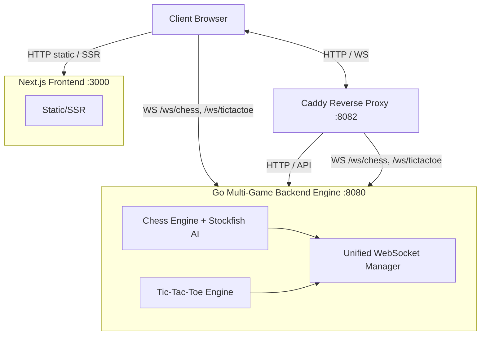
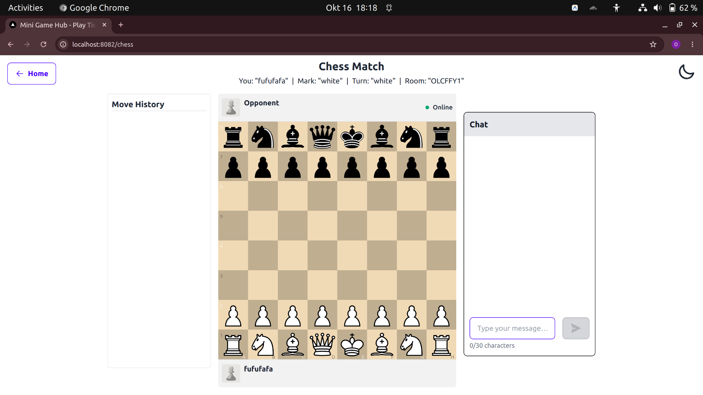
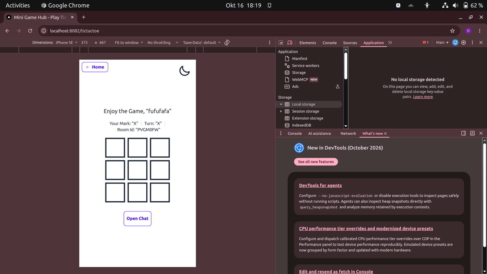
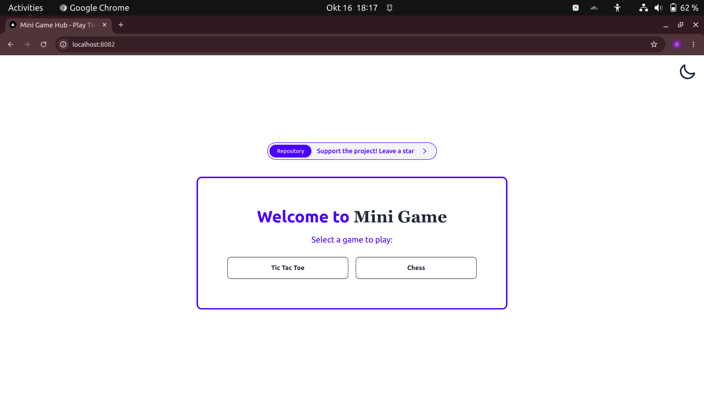
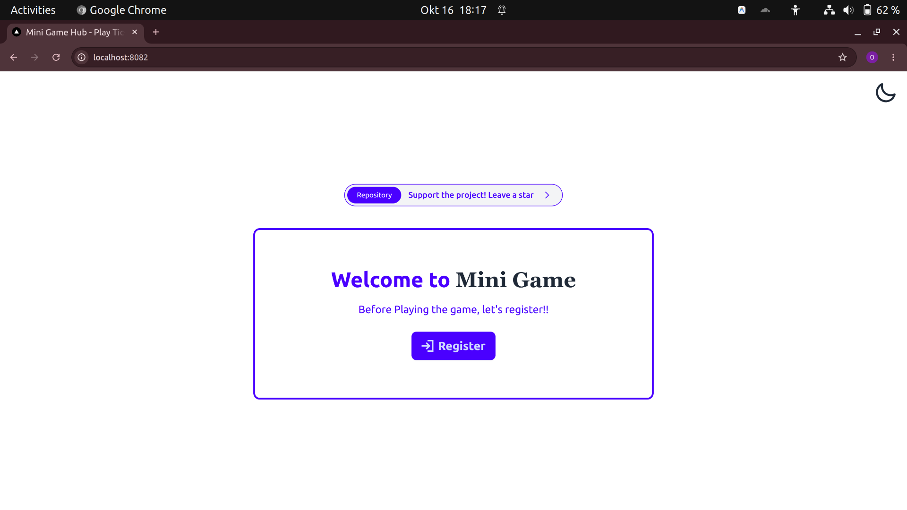

# Real-Time Multi-Game Engine & Platform

    

---

## Project Vision

A **modular, real‑time mini‑game platform** built on WebSockets, designed to host multiple turn‑based games with a unified matchmaking, session recovery, and AI integration. The architecture makes it trivial to plug in new games while re‑using the same backend infrastructure.

Currently supported games:
| Game | Mode | AI Integration | Matchmaking / Room System | Session Recovery |
|------|------|----------------|---------------------------|------------------|
| **Chess** | Real‑time multiplayer & AI (Stockfish) | Stockfish levels 1‑10 | Room‑based, player‑to‑player or AI opponent | Automatic reconnection & state sync |
| **Tic‑Tac‑Toe** | Real‑time multiplayer & AI | Simple minimax AI (adjustable difficulty) | Same room system as Chess | Automatic reconnection & state sync |

---

## Tech Stack

| Layer                | Technology                                                                                                                                                               |
| -------------------- | ------------------------------------------------------------------------------------------------------------------------------------------------------------------------ |
| **Frontend**         | **Next.js** (React) – UI built with **Chessground** for chess and a custom board for Tic‑Tac‑Toe. Tailwind‑CSS for responsive design.                                    |
| **Backend**          | **Go** – Multi‑game engine exposing HTTP API and unified WebSocket endpoints. Each game implements a `GameEngine` interface, making it straightforward to add new games. |
| **Reverse Proxy**    | **Caddy** – TLS termination, dynamic origin validation, and proxying of HTTP & WS traffic.                                                                               |
| **Containerisation** | **Docker** & **Docker‑Compose** – One‑click local development and production‑ready deployment.                                                                           |

---

## System Architecture



**Scalable Architecture Highlights**

- The backend defines a `GameEngine` interface; each game registers its own implementation (e.g., Chess, Tic‑Tac‑Toe). Adding a new turn‑based game only requires implementing this interface and wiring it into the unified WebSocket router.
- Unified WebSocket manager routes messages based on a `game_type` field, keeping connection handling DRY.
- Session recovery logic is shared across games: state snapshots are persisted per room, allowing clients to reconnect without losing progress.

---

## Technical Highlights

- **Unified WebSocket Manager** – Handles connections for multiple games, multiplexing messages via a `game` identifier.
- **Modular Game Engines** – Each game implements the same interface (`Init`, `HandleMove`, `GenerateAI`, `Snapshot`), enabling plug‑and‑play addition of new games.
- **AI Integration** – Chess uses Stockfish; Tic‑Tac‑Toe uses a lightweight minimax AI with configurable difficulty.
- **Dynamic Origin Validation** – Caddy forwards a whitelist (`ALLOWED_ORIGINS`) to the backend, which validates WebSocket origins at runtime.
- **Session Recovery** – Automatic reconnection handling with state re‑sync; players can rejoin after network interruptions.
- **Responsive UI** – Chessground for chess and a custom React board for Tic‑Tac‑Toe, both work on desktop, tablet, and mobile.

---

## Quick Start / How to Run

```bash
# 1️⃣ Clone the repository
git clone https://github.com/your-username/mini-game.git
cd mini-game

# 2️⃣ (Optional) Create a .env file to override defaults – see "Environment Variables" below.
#    The defaults are sufficient for local development.

# 3️⃣ Build and start the stack using Docker Compose
docker compose up --build   # or: docker compose up -d --build
```

The platform will be reachable at **http://localhost:8082** (Caddy fronts the services).

### Stopping the stack

```bash
docker compose down
```

---

## Environment Variables

### Backend (`services.backend.environment`)

| Variable                              | Description                                                                                                                            | Default                                                                               |
| ------------------------------------- | -------------------------------------------------------------------------------------------------------------------------------------- | ------------------------------------------------------------------------------------- |
| `PORT`                                | Port for the Go HTTP server.                                                                                                           | `8080`                                                                                |
| `ALLOWED_ORIGINS`                     | Comma‑separated list of origins allowed for WebSocket connections. Must include your development host (e.g., `http://localhost:3000`). | See `docker-compose.yml` – includes common localhost origins and `${DOMAIN}` fallback |
| `STOCKFISH_PATH`                      | Path to the Stockfish binary inside the container.                                                                                     | `/usr/games/stockfish`                                                                |
| `MAX_ACTIVE_AI_ROOMS`                 | Maximum concurrent rooms with AI opponents.                                                                                            | `10`                                                                                  |
| `RATE_LIMIT_RPS` / `RATE_LIMIT_BURST` | Simple rate‑limiting for API endpoints.                                                                                                | `20` / `40`                                                                           |

### Frontend (`services.frontend.build.args`)

| Variable                       | Description                                                        | Default                               |
| ------------------------------ | ------------------------------------------------------------------ | ------------------------------------- |
| `NEXT_PUBLIC_HTTP_BACKEND_URL` | Base URL for the REST API (e.g., `http://localhost:8082`).         | _empty – Caddy proxies automatically_ |
| `NEXT_PUBLIC_WS_BACKEND_URL`   | Base URL for the WebSocket endpoint (e.g., `ws://localhost:8082`). | _empty – Caddy proxies automatically_ |

> **Tip:** Create a `.env` file in the repository root with `VARIABLE=value` pairs; Docker Compose loads it automatically.

---

## Screenshots

|                  Chess Game                  |                    Tic-Tac-Toe Game                    |
| :------------------------------------------: | :----------------------------------------------------: |
|  |  |

|                 Lobby                  |                  Register View                  |
| :------------------------------------: | :-------------------------------------------: |
|  |  |

---

## Cheatsheet – Common Commands

```bash
# Rebuild containers after code changes
docker compose up --build

# Run only the backend (for fast Go tests)
cd server && go run ./cmd/main.go

# View logs for a specific service
docker compose logs -f backend

# Remove all containers, networks, and volumes
docker compose down -v
```

---

## Git Tag Instructions (v1.0.0)

```bash
# Ensure you are on the commit you want to tag (e.g., main)
git checkout main

git pull origin main   # optional but recommended

# Create an annotated tag
git tag -a v1.0.0 -m "Portfolio Release – v1.0.0 – Multi‑Game Platform"

git push origin v1.0.0
```

The tag will appear in the repository’s releases page.

---

## License

This project is licensed under the **MIT License** – see the `LICENSE` file for details.

---

_Enjoy building and extending your real‑time multi‑game experiences!_
